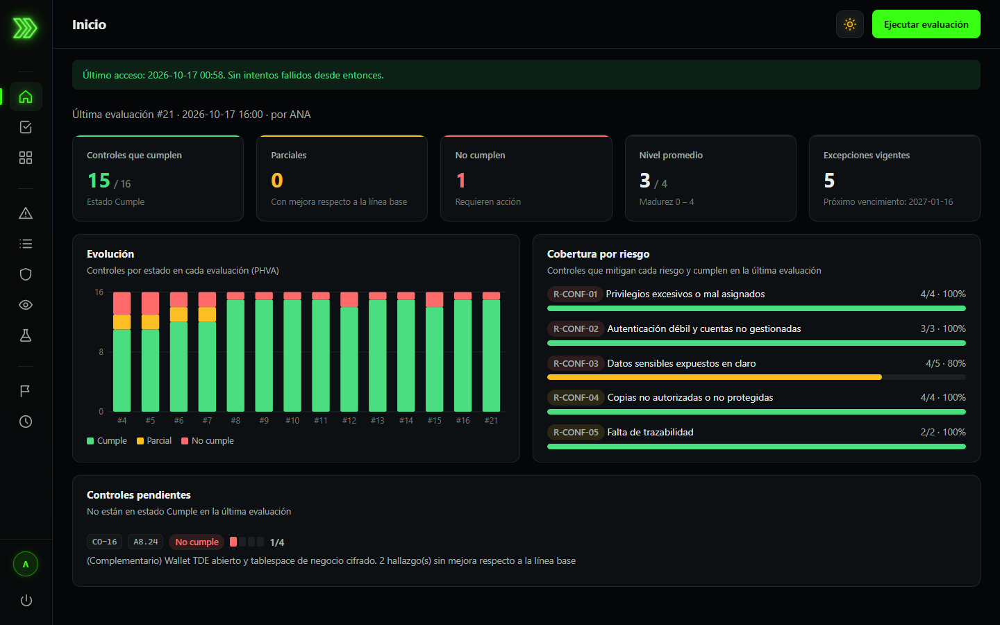
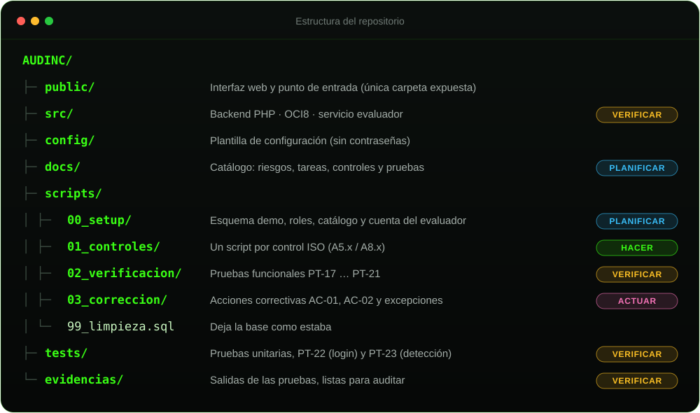
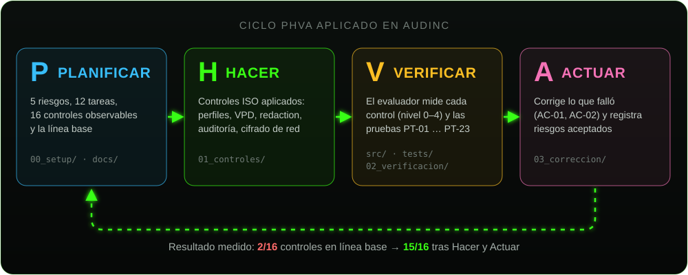

<p align="center">
  
</p>

<p align="center">
  
  
  
  
  
</p>

<p align="center">
  <b>AUDINC</b> evalúa, con evidencia observable, los controles del Anexo A de ISO/IEC 27001:2022 que protegen la
  <b>confidencialidad</b> en Oracle Database: mide cada control, lo califica con madurez 0–4 y guarda un histórico
  que nadie puede alterar.
</p>

---

## ✦ Vista previa

<picture>
  <source media="(prefers-color-scheme: dark)" srcset="docs/img/captura-oscuro.png">
  <source media="(prefers-color-scheme: light)" srcset="docs/img/captura-claro.png">
  
</picture>

<sub>La captura se adapta al tema de GitHub: modo noche (neón) o modo día. La aplicación incluye ambos.</sub>

## ✦ Qué hace

| | |
|---|---|
| 🎯 **5 riesgos, 12 tareas del DBA, 16 controles observables** | Catálogo completo mapeado a ISO/IEC 27001:2022 (A5.x / A8.x) |
| 🔍 **Evaluación con un clic** | Ejecuta la consulta de evidencia de cada control contra el diccionario de Oracle |
| 📊 **Matriz de madurez 0–4** | Tarea · Riesgo · Control · Criterio · Evidencia · Estado, como pide el enunciado |
| 🛡️ **Controles reales aplicados** | Perfiles, VPD, Data Redaction, auditoría unificada, cifrado de red AES-256 |
| 🔐 **Login con cuentas Oracle** | Sin contraseñas en la aplicación; solo el rol `AUDITOR`; trazabilidad por usuario |
| 🧾 **Evidencia inalterable** | La cuenta del evaluador solo puede insertar y leer (`ORA-01031` al intentar modificar) |

## ✦ Estructura

<p align="center">
  
</p>

## ✦ Metodología PHVA

Los scripts y las carpetas siguen el ciclo **Planificar → Hacer → Verificar → Actuar**: cada fase deja evidencia
en el repositorio y el evaluador mide el efecto de cada vuelta del ciclo.

<p align="center">
  
</p>

---

## ⚡ Inicio rápido

> [!IMPORTANT]
> Requisitos: **Oracle Database 21c XE** (PDB `XEPDB1`), **SQL\*Plus o SQL Developer** con acceso `SYS AS SYSDBA`
> y **PHP 8.1+** con la extensión OCI8 habilitada en `php.ini` (`extension=oci8_19`). No requiere Apache, WAMP ni XAMPP.

**1 · Planificar: instalar el entorno**

```bash
cd scripts/00_setup
sqlplus / as sysdba @00_instalar.sql
```

El script pide dos contraseñas (`AUDINC_APP` y usuarios de prueba); ninguna credencial se guarda en el repositorio.
Deja **brechas intencionales** para que la primera evaluación muestre la línea base.

> [!TIP]
> En SQL Developer: ejecutar como script (F5) con la codificación del editor en **UTF-8**
> (Herramientas → Preferencias → Entorno → Codificación). Para reinstalar: `@scripts/99_limpieza.sql`.

**2 · Iniciar el evaluador**

```bash
# config/config.local.php = copia de config.example.php con la contraseña de AUDINC_APP
php -S localhost:8000 -t public public/index.php
```

Abrir **http://localhost:8000** e iniciar sesión con una cuenta Oracle con rol `AUDITOR` (entorno de prueba: `ANA`).
Ejecutar la primera evaluación → **línea base**.

**3 · Hacer: aplicar los controles**

```bash
cd scripts/01_controles
sqlplus / as sysdba @00_aplicar_controles.sql
```

Clasificación (A5.12), privilegios (A5.15 / A5.18 / A8.2), cuentas (A5.16), perfiles (A5.17 / A8.5), VPD (A8.3),
eliminación segura (A8.10), Data Redaction (A8.11), fuga de datos (A8.12) y auditoría unificada (A8.15).
Fuera de la base, con aprobación: `A8.20_cifrado_red.md`, `A8.24_tde.sql`, `A8.13_respaldos.rman`.

**4 · Verificar y Actuar:** evaluar de nuevo, revisar los pendientes y aplicar `scripts/03_correccion/`.

## 🧪 Pruebas

| Prueba | Cómo se ejecuta | Qué demuestra |
|---|---|---|
| PT-01 … PT-16 | Botón **Ejecutar evaluación** | Una consulta de evidencia por control observable |
| PT-17 … PT-21 | `cd scripts/02_verificacion` → `sqlplus /nolog @00_pruebas_funcionales.sql` | Redaction, VPD, bloqueo por intentos, privilegios y auditoría, con cada usuario de prueba |
| PT-22 | `php tests/PT-22_login.php` | Login con cuentas Oracle, rol AUDITOR, cookie segura y trazabilidad |
| PT-23 | `php tests/PT-23_deteccion_y_correccion.php` | El evaluador **detecta** una brecha real (`GRANT` a `PUBLIC`) y registra su **corrección** |
| Unitarias | `php tests/ejecutar_pruebas.php` | Calificación 0–4 y excepciones (no requiere Oracle) |

Las salidas quedan en [`evidencias/salidas/`](evidencias/salidas/), listas para auditar.

---

<details>
<summary><b>🔐 Autenticación y seguridad de la aplicación</b></summary>

<br>

El evaluador **no guarda contraseñas**: el usuario inicia sesión con su **cuenta de Oracle** y la aplicación
la verifica abriendo una sesión en Oracle. Así aplican también a la aplicación los controles del perfil
`AUDINC_SEGURO`: bloqueo tras 3 intentos, expiración, complejidad y registro de intentos fallidos (`ORA_LOGON_FAILURES`).

- Solo entran cuentas con el rol `AUDITOR`; mismo mensaje de error para usuario inexistente, contraseña incorrecta o cuenta bloqueada.
- Sesión con cookie `HttpOnly` + `SameSite=Strict`, id regenerado al iniciar sesión, cierre por 15 min de inactividad y máximo 8 h.
- Las consultas usan la cuenta de servicio `AUDINC_APP`, pero cada petición identifica al usuario final con
  `DBMS_SESSION.SET_IDENTIFIER`: queda en `UNIFIED_AUDIT_TRAIL.CLIENT_IDENTIFIER` y como autor de cada evaluación.
- Solo se expone `public/`; rutas validadas con `realpath` (sin `../`).
- Cabeceras `Content-Security-Policy` (solo recursos propios), `X-Frame-Options`, `X-Content-Type-Options`, `Cache-Control: no-store`.
- Variables bind en todas las consultas; tiempo máximo de 30 s por llamada a Oracle.
- Los errores de Oracle se registran en el servidor; al cliente solo llega el código `ORA-xxxxx`.
- `POST` exige `Content-Type: application/json` (protección CSRF).
- Front sin frameworks ni CDN; todo el contenido dinámico se inserta como texto (`textContent`) para evitar XSS.

</details>

<details>
<summary><b>🖥️ Interfaz web</b></summary>

<br>

- Menú lateral contraído (flecha neón + íconos) que se despliega con animación al pasar el mouse o con el teclado; en celular se abre tocando la flecha.
- **Inicio:** indicadores, evolución PHVA y cobertura por riesgo con carga animada.
- **Evaluaciones** con el detalle de la evidencia de cada control · **Matriz** filtrable · **Riesgos** con mapa de calor ·
  Tareas · Controles ISO · Controles observables (con su consulta SQL) · Batería de pruebas · Excepciones · **Mi actividad**.
- Modo **día / noche** con preferencia guardada en el navegador; respeta `prefers-reduced-motion`.

</details>

<details>
<summary><b>🔌 API</b></summary>

<br>

Todas las rutas `/api/*` requieren sesión, excepto `/api/sesion`.

| Método | Ruta | Devuelve |
|---|---|---|
| POST | `/api/sesion` | Inicia sesión. JSON: `{"usuario": "...", "contrasena": "..."}` |
| GET | `/api/sesion` | Sesión actual (usuario, inicio, acceso anterior) |
| DELETE | `/api/sesion` | Cierra sesión |
| GET | `/api/mi-actividad` | Cuenta propia, acceso anterior, intentos fallidos (30 días) y evaluaciones lanzadas |
| GET | `/api/resumen` | Última evaluación, evolución, cobertura por riesgo, pendientes y excepciones por vencer |
| GET | `/api/riesgos` | Riesgos R-CONF con impacto, probabilidad, nivel y clasificación |
| GET | `/api/tareas` | Tareas del DBA con sus riesgos y controles |
| GET | `/api/controles` | Controles ISO/IEC 27001:2022 del Anexo A |
| GET | `/api/controles-observables` | Controles observables con su consulta de evidencia |
| GET | `/api/pruebas` | Batería de pruebas PT-01 … PT-23 |
| GET | `/api/matriz` | Matriz Tarea / Riesgo / Control / Criterio 0–4 / Estado |
| GET | `/api/excepciones` | Excepciones aprobadas con su vencimiento |
| GET | `/api/evaluaciones` | Histórico de evaluaciones |
| GET | `/api/evaluaciones/{id}` | Detalle de una evaluación con la evidencia de cada control |
| POST | `/api/evaluaciones` | Ejecuta una evaluación. JSON: `{"observaciones": "..."}` |

</details>

<details>
<summary><b>🗄️ Qué crea el setup en Oracle</b></summary>

<br>

| Objeto | Tipo | Propósito |
|---|---|---|
| `AUDINC_DEMO` | Esquema sin login (`NO AUTHENTICATION`) | Datos de negocio **ficticios** con datos personales (Ley 8968) |
| `VENDEDOR`, `SUPERVISOR`, `AUDITOR` | Roles | Acceso por rol (A5.18) |
| `JUAN`, `PEDRO`, `ANA`, `LUIS`, `TEMPORAL` | Usuarios de prueba | Escenarios de las pruebas funcionales |
| `AUDINC_OWNER` | Esquema sin login | Catálogo y resultados de las evaluaciones |
| `AUDINC_EVALUADOR` / `AUDINC_APP` | Rol / usuario | Cuenta de solo lectura del evaluador (mínimo privilegio) |

Brechas intencionales de la línea base: grant a `PUBLIC`, privilegio directo, `SELECT ANY TABLE`, cuenta sin uso
y copia de datos personales en la papelera.

</details>

<details>
<summary><b>🛠️ Acciones correctivas (fase Actuar)</b></summary>

<br>

- [`AC-01_A8.12.md`](scripts/03_correccion/AC-01_A8.12.md): la revocación de `UTL_*` a `PUBLIC` invalidó 123 objetos de Oracle; reversión inmediata y rediseño del control con reversión automática.
- [`AC-02_cuentas_y_excepciones.sql`](scripts/03_correccion/AC-02_cuentas_y_excepciones.sql): bloqueo de `PDBADMIN` y excepciones aprobadas, con vencimiento, para objetos de otro proyecto que comparte la instancia.

</details>

---

<p align="center">
  <sub>Catálogo completo de riesgos, controles y criterios en <a href="docs/catalogo_controles.md"><code>docs/catalogo_controles.md</code></a></sub><br>
  <sub>EIF402 Administración de Bases de Datos · Escuela de Informática · Universidad Nacional de Costa Rica · 2026</sub>
</p>
