

<strong>Universidad Nacional de Costa Rica</strong> 
Facultad de Ciencias Exactas y Naturales 
Escuela de Informática 
EIF402 Administración de Bases de Datos

<h1>AUDINC</h1>

Evaluador de confidencialidad ISO/IEC 27001:2022 para Oracle Database 21c XE

Manual de usuario

<strong>Profesor:</strong> Johnny Villalobos Murillo

<strong>Estudiante:</strong> Isaac Naranjo

II Ciclo 2026 · Heredia, Costa Rica · Octubre de 2026

# Manual de usuario de AUDINC

<!-- indice -->

## 1. Introducción

AUDINC es una aplicación web que evalúa, con evidencia tomada directamente de Oracle, si los controles de confidencialidad de ISO/IEC 27001:2022 están implementados en la base de datos. Cada evaluación ejecuta 16 consultas sobre el diccionario de datos, califica cada control con un nivel de madurez de 0 a 4 y guarda el resultado a nombre de quien la ejecutó. Además, la aplicación audita cada cuenta de usuario de Oracle.

Este manual está dirigido al **auditor**: la persona que consulta los resultados y ejecuta las evaluaciones. La instalación de la base de datos y del servidor se describe en el *Manual técnico*.

## 2. Requisitos para usar la aplicación

| Requisito | Detalle |
|---|---|
| Navegador | Microsoft Edge, Google Chrome o Mozilla Firefox actualizados |
| Dirección | http://localhost:8000 (el servidor del evaluador debe estar encendido) |
| Cuenta | Una cuenta de Oracle en la PDB `XEPDB1` con el rol `AUDITOR` (por ejemplo, `ISAAC`) |

La aplicación no tiene usuarios propios: se ingresa con la cuenta de Oracle y Oracle valida la contraseña. Por eso aplican las reglas del perfil de seguridad de la cuenta (bloqueo por intentos fallidos, vencimiento y complejidad de la contraseña).

## 3. Iniciar sesión

1. Abra http://localhost:8000 en el navegador.
2. Escriba su **usuario Oracle** (no distingue mayúsculas) y su **contraseña**.
3. Presione **Iniciar sesión**.

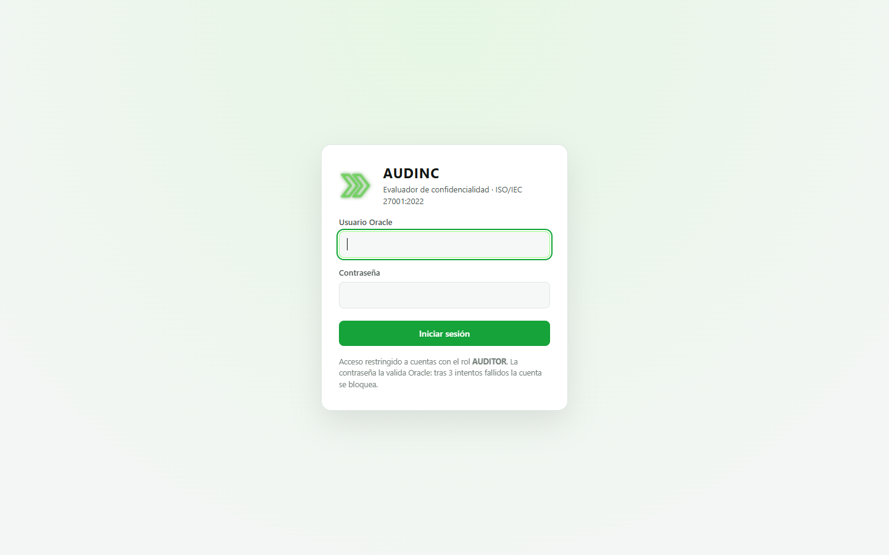

Figura 1. Pantalla de inicio de sesión.

Al entrar, la aplicación muestra un aviso con la fecha de su acceso anterior. Si hubo intentos fallidos de inicio de sesión con su cuenta desde entonces, el aviso aparece en rojo para que pueda detectar un posible uso indebido.

| Mensaje | Qué significa | Qué hacer |
|---|---|---|
| Usuario o contraseña inválidos, o cuenta bloqueada | La contraseña es incorrecta, el usuario no existe o la cuenta está bloqueada. Por seguridad, el mensaje es el mismo en los tres casos | Revise los datos. **Después de 3 intentos fallidos la cuenta se bloquea durante 1 hora** |
| Acceso restringido a usuarios con el rol AUDITOR | La contraseña es correcta, pero la cuenta no tiene el rol `AUDITOR` | Solicite el rol al administrador de la base de datos |
| La contraseña expiró | La contraseña superó su vigencia (90 días) | Cámbiela desde SQL Developer o SQL\*Plus y vuelva a intentar |
| Su sesión expiró o no ha iniciado sesión | Pasaron 15 minutos sin actividad o 8 horas desde el inicio de sesión | Inicie sesión de nuevo |

## 4. Pantalla principal y menú

La pantalla tiene tres zonas:

- **Menú lateral (izquierda).** Contraído muestra solo íconos; al pasar el mouse (o al navegar con el teclado) se despliega con el nombre de cada opción. En el celular se abre tocando la flecha.
- **Barra superior.** Título de la vista, botón de **modo día / noche** y botón **Ejecutar evaluación**.
- **Contenido.** La vista seleccionada.

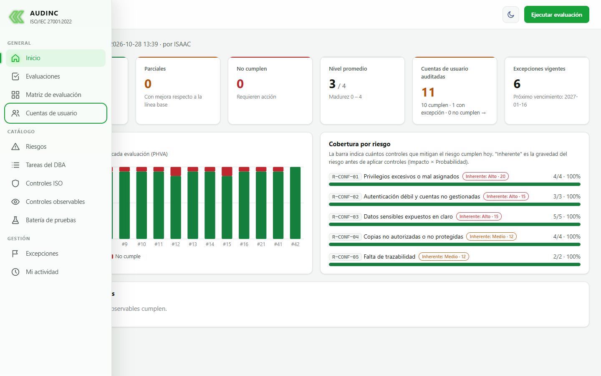

Figura 2. Menú lateral desplegado.

| Grupo | Opción | Para qué sirve |
|---|---|---|
| General | Inicio | Resumen del estado de seguridad |
| | Evaluaciones | Histórico de evaluaciones y su evidencia |
| | Matriz de evaluación | Tarea, riesgo, control, criterio, evidencia y estado |
| | Cuentas de usuario | Auditoría de cada cuenta de Oracle |
| Catálogo | Riesgos | Riesgos de confidencialidad y mapa de calor |
| | Tareas del DBA | Tareas críticas con sus riesgos y controles |
| | Controles ISO | Controles del Anexo A seleccionados |
| | Controles observables | Consultas de evidencia de cada control |
| | Batería de pruebas | Pruebas del proyecto |
| Gestión | Excepciones | Riesgos aceptados formalmente |
| | Mi actividad | Accesos y evaluaciones de su propia cuenta |

En la parte inferior del menú aparecen su usuario y el botón **Cerrar sesión**.

## 5. Inicio

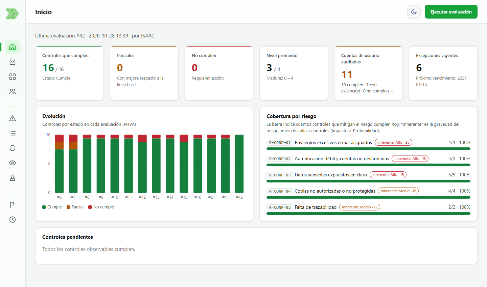

Figura 3. Inicio.

- **Indicadores.** Controles que cumplen, parciales, que no cumplen, nivel promedio de madurez, **cuentas de usuario auditadas** (con cuántas cumplen, cuántas tienen excepción y cuántas no cumplen; al hacer clic abre la sección de cuentas) y excepciones vigentes con su próximo vencimiento.
- **Evolución.** Gráfico de barras con el resultado de cada evaluación: verde Cumple, ámbar Parcial, rojo No cumple. Pase el mouse sobre una barra para ver el detalle.
- **Cobertura por riesgo.** Para cada riesgo, cuántos de los controles que lo mitigan cumplen hoy. La etiqueta "Inherente" indica la gravedad del riesgo antes de aplicar controles (impacto por probabilidad). Un riesgo inherente alto con cobertura del 100 % tiene un riesgo residual bajo.
- **Controles pendientes.** Los controles que no están en Cumple en la última evaluación, con la justificación de su nivel.

## 6. Ejecutar una evaluación

1. Presione **Ejecutar evaluación** en la barra superior.
2. Si lo desea, escriba una observación (por ejemplo, "Después de aplicar A8.11").
3. Presione **Ejecutar**.

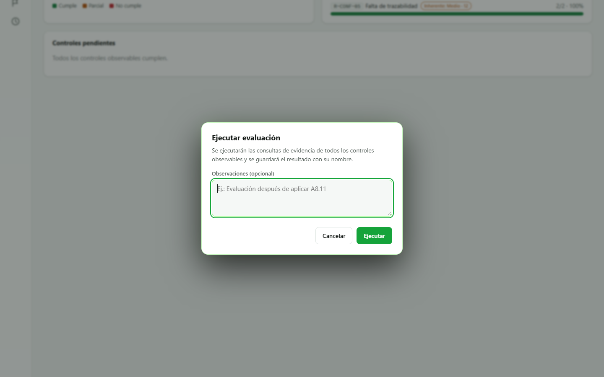

Figura 4. Diálogo para ejecutar una evaluación.

La aplicación ejecuta las 16 consultas de evidencia, califica cada control, guarda el resultado a su nombre y abre el detalle de la nueva evaluación. Las evaluaciones **no se pueden modificar ni eliminar**: la cuenta del evaluador solo tiene permiso para insertar y leer.

### Cómo interpretar el resultado

| Nivel | Significado | Estado |
|---|---|---|
| 0 | La consulta de evidencia no se pudo ejecutar | No cumple |
| 1 | Hay hallazgos y no hay mejora respecto a la primera evaluación (línea base) | No cumple |
| 2 | Hay hallazgos, pero menos que en la línea base | Parcial |
| 3 | Sin hallazgos (o sin hallazgos fuera de las excepciones aprobadas) | Cumple |
| 4 | Sin hallazgos en esta evaluación y en la anterior, sin depender de excepciones | Cumple |

Un **hallazgo** es una fila que devuelve la consulta de evidencia: un objeto que incumple el control (por ejemplo, un permiso concedido a `PUBLIC`). Cero hallazgos significa que el control se observa implementado.

## 7. Evaluaciones

La vista **Evaluaciones** lista todas las evaluaciones con su fecha, auditor, cantidad de controles por estado, nivel promedio y observaciones. Haga clic en el número de una evaluación para ver su detalle.

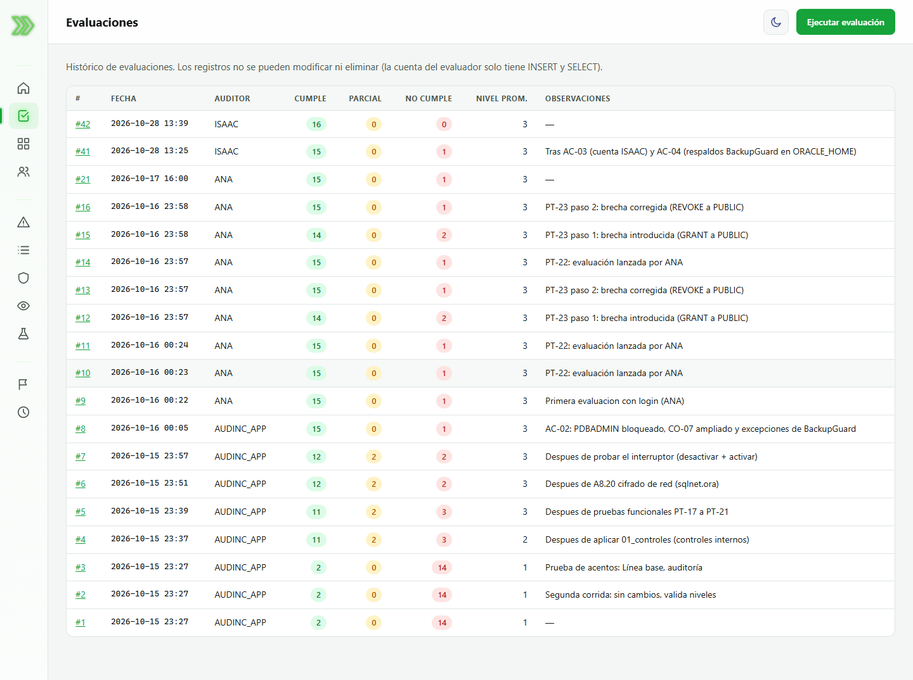

Figura 5. Histórico de evaluaciones.

El detalle muestra, para cada control observable, su nivel, su estado, la justificación del nivel y la **evidencia**: las filas que devolvió la consulta. Las filas cubiertas por una excepción aprobada aparecen aparte, en cursiva, bajo el título "Exceptuados por excepción aprobada".

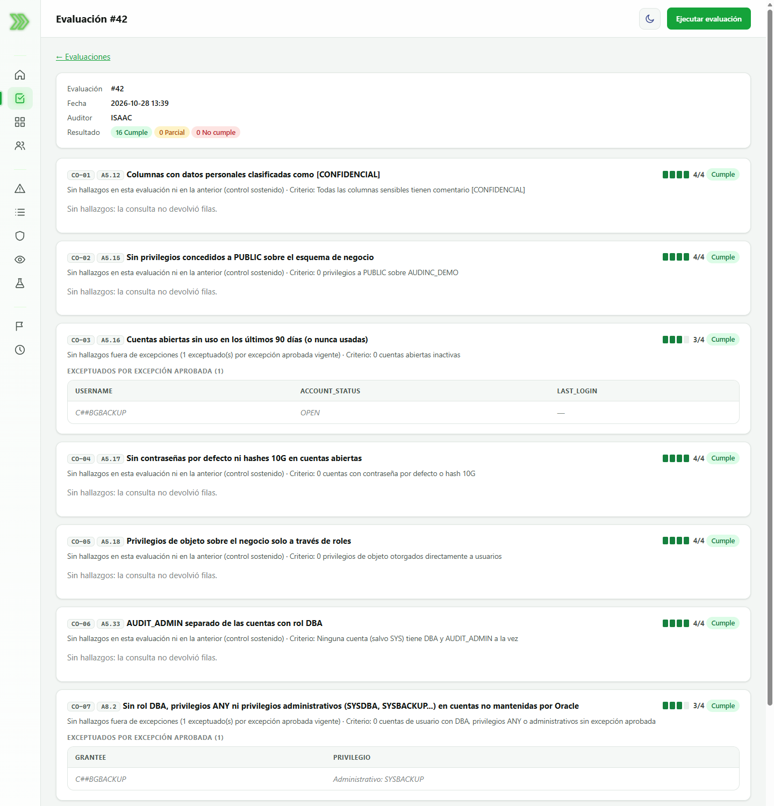

Figura 6. Detalle de una evaluación con su evidencia.

## 8. Matriz de evaluación

Presenta la matriz en el formato solicitado: **Tarea | Riesgo | Control | Criterio 0-4 | Evidencia | Estado**, con el resultado de la última evaluación. Use el filtro **Estado** para ver, por ejemplo, solo los controles que no cumplen, y el cuadro **Buscar** para filtrar por tarea, riesgo o control. El enlace de la columna Evidencia abre la evaluación correspondiente.

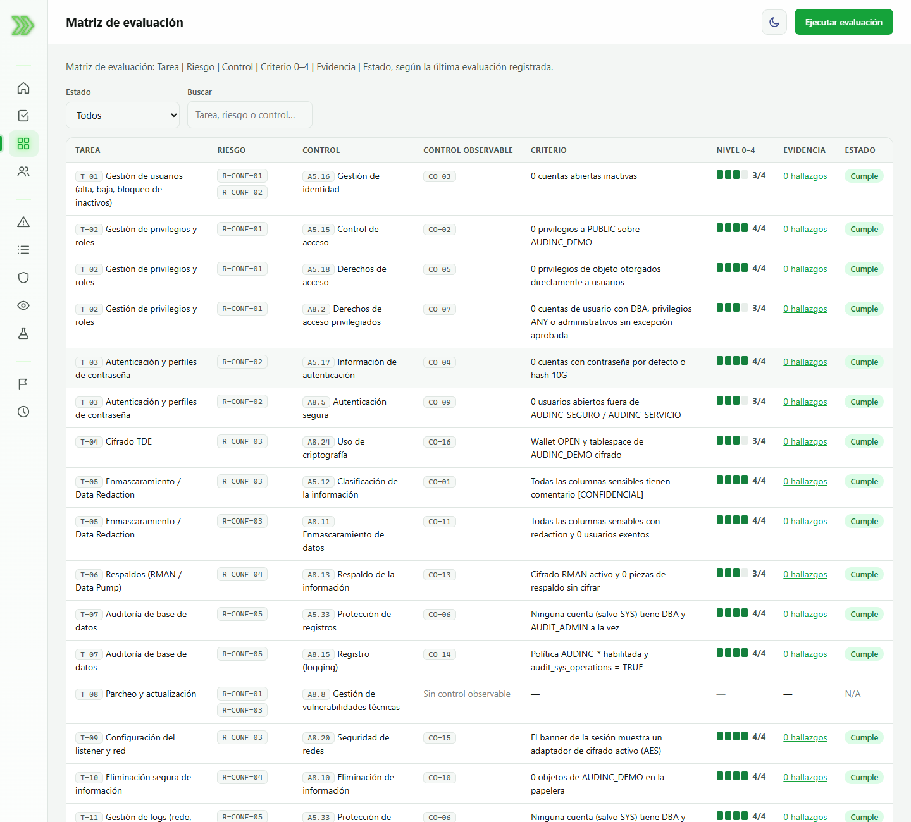

Figura 7. Matriz de evaluación.

## 9. Cuentas de usuario

Esta sección audita **todas las cuentas de usuario de Oracle** creadas en la PDB (no incluye las cuentas internas de Oracle). Cada cuenta se revisa contra 7 requisitos, con los mismos criterios que los controles observables. El cálculo se hace en vivo cada vez que abre la vista.

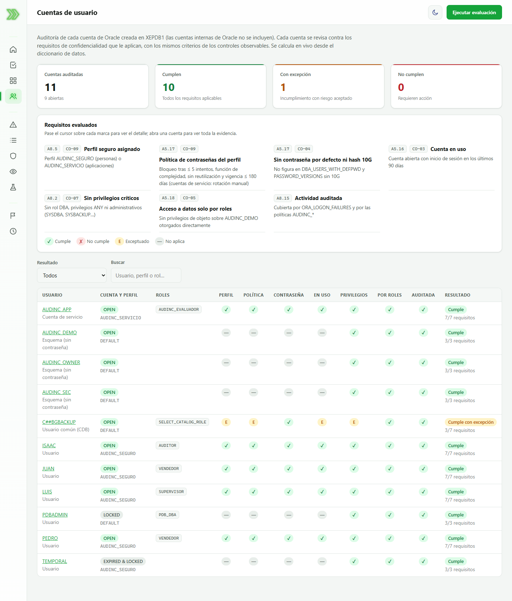

Figura 8. Cuentas de usuario: indicadores, requisitos evaluados y matriz por cuenta.

### Requisitos evaluados

| Columna | Requisito | Control ISO |
|---|---|---|
| Perfil | Tiene asignado un perfil seguro (`AUDINC_SEGURO` para personas, `AUDINC_SERVICIO` para aplicaciones) | A8.5 |
| Política | El perfil bloquea tras 5 intentos o menos, exige complejidad, impide reutilizar contraseñas y las hace vencer en 180 días o menos | A5.17 |
| Contraseña | No usa una contraseña por defecto de Oracle ni conserva el hash débil 10G | A5.17 |
| En uso | Inició sesión en los últimos 90 días | A5.16 |
| Privilegios | No tiene rol `DBA`, privilegios `ANY` ni privilegios administrativos | A8.2 |
| Por roles | No tiene permisos directos sobre los datos de negocio (solo a través de roles) | A5.18 |
| Auditada | Su actividad queda registrada por la auditoría unificada | A8.15 |

### Marcas y resultados

| Marca | Significado |
|---|---|
| ✓ (verde) | Cumple el requisito |
| ✗ (rojo) | No cumple el requisito |
| E (ámbar) | No cumple, pero hay una excepción aprobada y vigente para esa cuenta |
| Guion (gris) | No aplica: la cuenta está bloqueada o no tiene contraseña, por lo que no puede iniciar sesión |

El resultado de cada cuenta es **Cumple** (todos los requisitos aplicables se cumplen), **Cumple con excepción** (solo incumple requisitos exceptuados) o **No cumple**. Pase el mouse sobre una marca para ver el detalle, use los filtros para buscar cuentas, y haga clic en el nombre de una cuenta para abrir su ficha.

### Ficha de una cuenta

La ficha muestra los datos de la cuenta (estado, perfil, roles, fecha de creación, último acceso, vencimiento de la contraseña, intentos fallidos de los últimos 30 días), los **parámetros efectivos de su perfil**, la evidencia de cada requisito, las políticas de auditoría que la cubren y la lista de intentos fallidos de inicio de sesión.

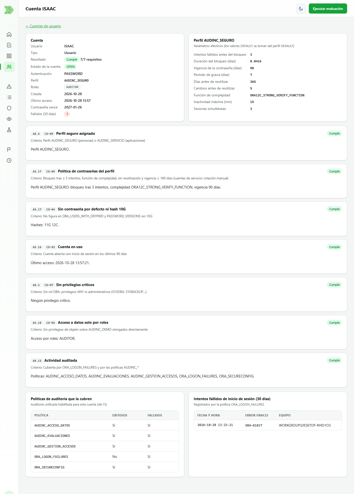

Figura 9. Ficha de una cuenta que cumple todos los requisitos.

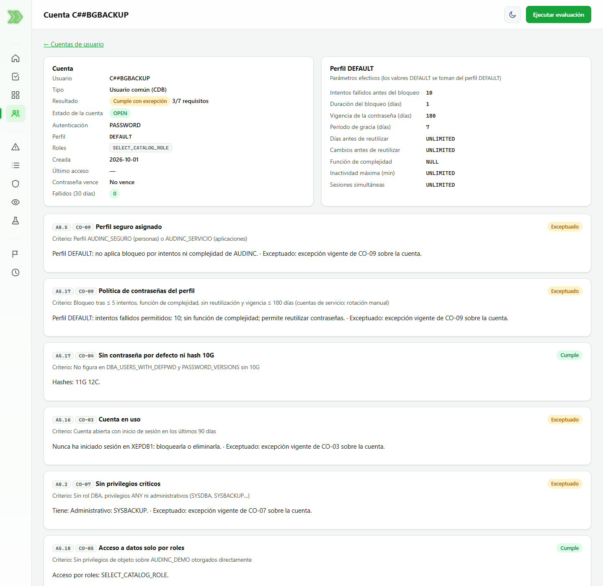

Figura 10. Ficha de una cuenta con requisitos exceptuados (usuario de otro proyecto que comparte la instancia).

## 10. Catálogo

Las vistas del grupo Catálogo son de consulta y muestran el contenido del artefacto:

- **Riesgos.** Mapa de calor de impacto por probabilidad, dimensiones de confidencialidad y tabla de los riesgos R-CONF-01 a R-CONF-05.
- **Tareas del DBA.** Las 12 tareas críticas con los riesgos que generan y los controles que las protegen.
- **Controles ISO.** Los controles del Anexo A seleccionados, con su justificación e implementación en Oracle. Los marcados como "Complementario" no estaban en la lista del enunciado.
- **Controles observables.** Cada control con su criterio de cumplimiento. El enlace "Ver consulta de evidencia (SQL)" muestra la consulta exacta, que puede copiarse y ejecutarse en SQL Developer.
- **Batería de pruebas.** Las pruebas PT-01 a PT-23 con su tipo, procedimiento, resultado esperado y herramienta.

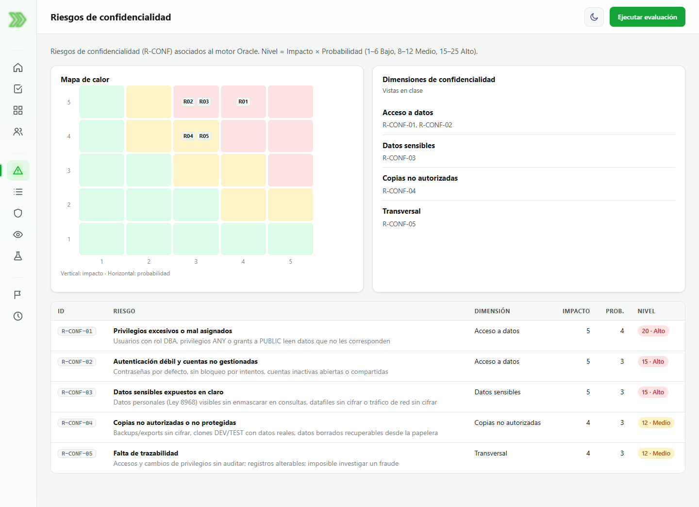

Figura 11. Riesgos de confidencialidad y mapa de calor.

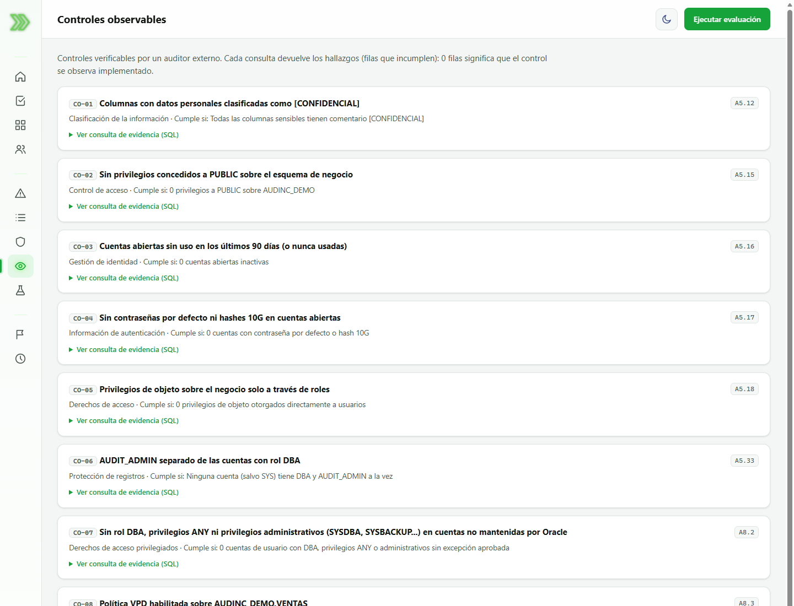

Figura 12. Controles observables con su consulta de evidencia.

## 11. Excepciones

Lista los riesgos aceptados formalmente: control, objeto exceptuado, justificación, control compensatorio, quién lo aprobó, fecha de vencimiento y estado (Vigente o Vencida). Un hallazgo exceptuado no cuenta como incumplimiento, pero sigue visible en la evidencia, y el control no puede pasar del nivel 3. Cuando una excepción vence, el hallazgo vuelve a contarse en la siguiente evaluación. Las excepciones se registran desde la base de datos, no desde la aplicación.

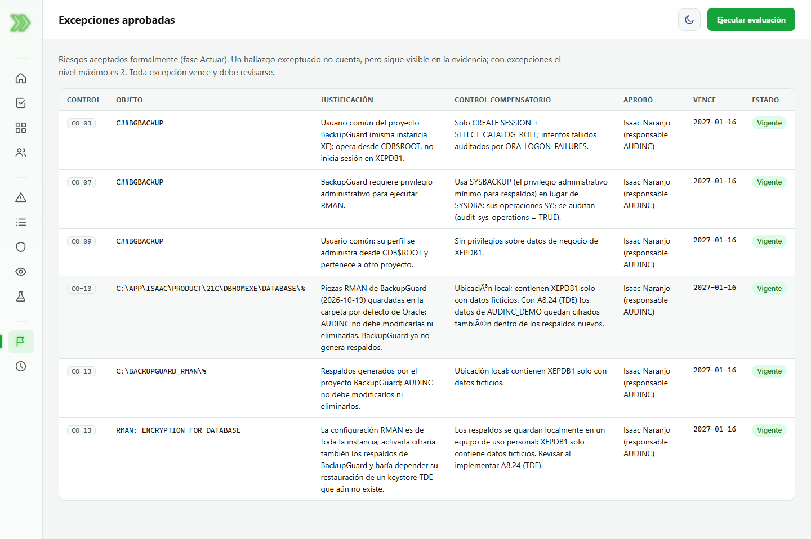

Figura 13. Excepciones aprobadas.

## 12. Mi actividad

Muestra la información de su propia cuenta registrada por Oracle: estado, perfil, vencimiento de la contraseña, acceso anterior, intentos fallidos desde ese acceso, evaluaciones que usted lanzó e intentos fallidos de los últimos 30 días. Puede consultarla, pero no modificarla ni borrarla (separación de funciones, A5.33).

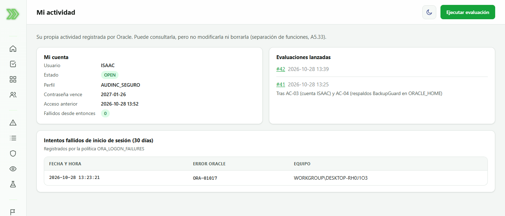

Figura 14. Mi actividad.

## 13. Modo día y noche, y cierre de sesión

- El botón con el ícono de luna o sol, junto a **Ejecutar evaluación**, alterna entre el modo noche (fondo negro con acento verde) y el modo día (fondo claro). La preferencia se recuerda en el navegador.
- Para salir, use **Cerrar sesión** al final del menú. La sesión también se cierra sola tras 15 minutos sin actividad o 8 horas después de iniciada.

## 14. Preguntas frecuentes

**¿Por qué una cuenta aparece como "Cumple con excepción"?** Porque incumple uno o más requisitos, pero existe una excepción aprobada y vigente que acepta ese riesgo. Revise la justificación en la vista Excepciones.

**¿Por qué mi cuenta aparece como "No cumple" en "En uso"?** Una cuenta abierta que no ha iniciado sesión en 90 días se considera inactiva. Basta con iniciar sesión para que el requisito se cumpla.

**¿Puedo borrar una evaluación equivocada?** No. El histórico es inalterable por diseño; ejecute una nueva evaluación con una observación que lo explique.

**¿Puedo ejecutar las consultas fuera de la aplicación?** Sí. Copie la consulta desde Controles observables y ejecútela en SQL Developer con una cuenta que pueda leer el diccionario de datos.
