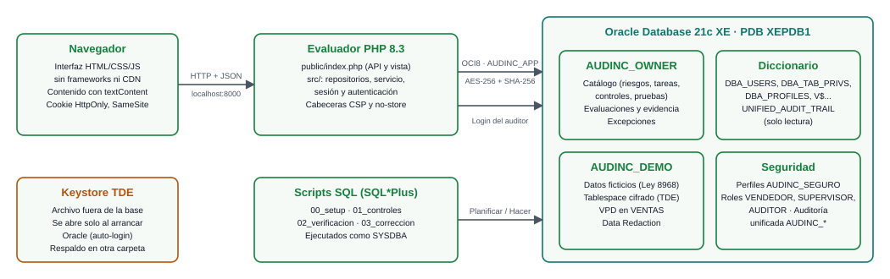
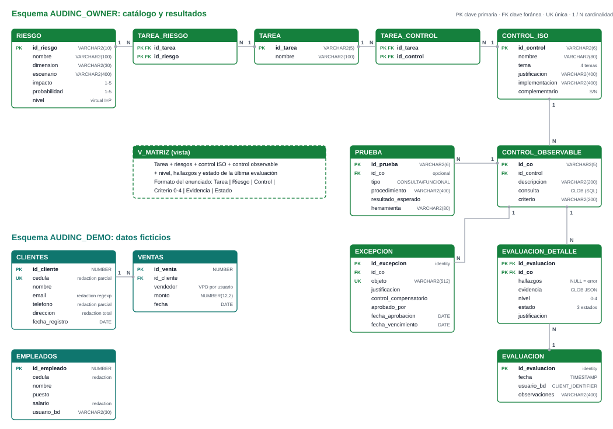

<div class="portada">
<div class="institucion">
<strong>Universidad Nacional de Costa Rica</strong><br>
Facultad de Ciencias Exactas y Naturales<br>
Escuela de Informática<br>
EIF402 Administración de Bases de Datos
</div>
<div class="titulo">
<h1>AUDINC</h1>
<p>Evaluador de confidencialidad ISO/IEC 27001:2022 para Oracle Database 21c XE</p>
<span class="tipo">Manual técnico</span>
</div>
<div class="datos">
<p><strong>Profesor:</strong> Johnny Villalobos Murillo</p>
<p><strong>Estudiante:</strong> Isaac Naranjo</p>
<p><strong>Repositorio:</strong> https://github.com/Isaac-Naranjo/AUDINC</p>
<p>II Ciclo 2026 · Heredia, Costa Rica · Octubre de 2026</p>
</div>
</div>

<div class="salto"></div>

# Manual técnico de AUDINC

<!-- indice -->

## 1. Propósito y alcance

Este manual describe cómo está construido AUDINC, cómo instalarlo desde cero y cómo operarlo: arquitectura, requisitos, instalación, modelo de base de datos, lógica del evaluador, API, seguridad, pruebas y solución de problemas. Está dirigido a quien administre la base de datos o mantenga el código. El uso de la interfaz se explica en el *Manual de usuario*.

## 2. Arquitectura

AUDINC tiene tres componentes: la base de datos Oracle (donde viven el catálogo, los resultados y los datos de prueba), un evaluador en PHP que expone una API y sirve la interfaz, y la interfaz web que se ejecuta en el navegador. Los controles se aplican con scripts SQL ejecutados como `SYSDBA`.

<div class="figura">

<p class="leyenda">Figura 1. Arquitectura de AUDINC.</p>
</div>

| Componente | Tecnología | Responsabilidad |
|---|---|---|
| Base de datos | Oracle Database 21c XE 21.3, PDB `XEPDB1` | Catálogo, evaluaciones, datos de prueba, controles de seguridad |
| Evaluador | PHP 8.3 con OCI8, servidor integrado de PHP | API REST, autenticación, ejecución de las consultas de evidencia, calificación |
| Interfaz | HTML, CSS y JavaScript sin frameworks ni CDN | Vistas del artefacto |
| Scripts | SQL\*Plus / SQL Developer | Instalación, aplicación de controles, pruebas, correcciones |

**Decisiones de diseño principales:**

- **Consultas de hallazgos.** Cada control observable es una consulta que devuelve las filas que incumplen; 0 filas significa cumple. Así la evidencia de un incumplimiento es la propia fila.
- **Catálogo en tablas Oracle** y no en archivos, para que el histórico de evaluaciones quede en la base y pueda auditarse.
- **Autenticación delegada a Oracle.** La aplicación no guarda contraseñas: valida las credenciales abriendo una sesión en Oracle, de modo que aplican los controles del perfil (bloqueo, vencimiento, complejidad).
- **Mínimo privilegio en la cuenta de servicio.** `AUDINC_APP` solo lee las vistas del diccionario que usan las consultas y el catálogo, e inserta resultados; no puede modificar ni borrar la evidencia ni las consultas.

## 3. Requisitos

| Requisito | Versión o detalle |
|---|---|
| Sistema operativo | Windows 10 u 11 (probado en Windows 11) |
| Oracle Database | 21c Express Edition con la PDB `XEPDB1` |
| Acceso administrativo | `sqlplus / as sysdba` (autenticación del sistema operativo) |
| PHP | 8.1 o superior (probado con 8.3) con la extensión OCI8 habilitada en `php.ini` (`extension=oci8_19`) y las bibliotecas cliente de Oracle accesibles en el `PATH` |
| Navegador | Edge, Chrome o Firefox actualizados |
| Opcional | Git, Node.js 18 o superior (solo para regenerar los PDF de la documentación) |

No se requiere Apache, WAMP ni XAMPP: se usa el servidor integrado de PHP.

## 4. Estructura del repositorio

| Ruta | Contenido |
|---|---|
| `public/` | Única carpeta expuesta por el servidor: `index.php` (punto de entrada y API) y `assets/` (CSS, JavaScript, íconos) |
| `src/` | Código PHP: `Database.php` (envoltorio de OCI8), `Repositorio/` (consultas), `Servicio/EvaluadorServicio.php` (evaluación y calificación), `Seguridad/` (sesión y autenticación), `Vista/app.html` |
| `config/` | `config.example.php` (plantilla); `config.local.php` con la contraseña real, ignorado por Git |
| `scripts/00_setup/` | Instalación (Planificar) |
| `scripts/01_controles/` | Un script por control (Hacer) |
| `scripts/02_verificacion/` | Pruebas funcionales PT-17 a PT-21 (Verificar) |
| `scripts/03_correccion/` | Acciones correctivas AC-01 a AC-04 (Actuar) |
| `scripts/99_limpieza.sql` | Elimina todos los objetos de AUDINC |
| `tests/` | PT-22, PT-23 y pruebas unitarias |
| `evidencias/salidas/` | Salidas de las pruebas funcionales |
| `docs/` | Catálogo de controles y documentos de entrega |

## 5. Instalación

### 5.1 Base de datos (Planificar)

```
cd scripts\00_setup
sqlplus / as sysdba @00_instalar.sql
```

El script pide dos contraseñas, que no se guardan en el repositorio: la de `AUDINC_APP` (cuenta del evaluador) y la de los usuarios de prueba. Ejecuta en orden:

| Script | Qué crea |
|---|---|
| `01_esquema_demo.sql` | Esquema `AUDINC_DEMO` con `CLIENTES`, `VENTAS` y `EMPLEADOS` (datos ficticios) |
| `02_roles_usuarios.sql` | Roles `VENDEDOR`, `SUPERVISOR`, `AUDITOR`; usuarios `JUAN`, `PEDRO`, `ISAAC`, `LUIS`, `TEMPORAL`; **brechas intencionales** de la línea base |
| `03_catalogo.sql` | Esquema `AUDINC_OWNER` con las tablas del catálogo y de resultados, y la vista `V_MATRIZ` |
| `04_catalogo_datos.sql` | Riesgos, tareas, controles ISO, controles observables (con sus consultas) y pruebas |
| `05_evaluador.sql` | Rol `AUDINC_EVALUADOR` y cuenta `AUDINC_APP` |

Las contraseñas deben escribirse a mano cuando SQL\*Plus las pida. Si se pasan por una tubería desde PowerShell, este agrega un carácter invisible (BOM) al inicio y la contraseña queda distinta de la esperada.

Los scripts están guardados en UTF-8. Si se ejecutan desde una consola, antes de abrir SQL\*Plus hay que indicar esa codificación; de lo contrario los acentos se guardan mal (por ejemplo "Ubicación"):

```
$env:NLS_LANG = 'AMERICAN_AMERICA.AL32UTF8'     # PowerShell
set NLS_LANG=AMERICAN_AMERICA.AL32UTF8          # Símbolo del sistema (cmd)
```

En SQL Developer, ejecutar como script (F5) con la codificación del editor en UTF-8 (Herramientas, Preferencias, Entorno, Codificación).

### 5.2 Evaluador

1. Copiar `config/config.example.php` como `config/config.local.php` y escribir la contraseña de `AUDINC_APP`.
2. Verificar que OCI8 está cargado: `php -m` debe listar `oci8`.
3. Desde la raíz del repositorio:

```
php -S localhost:8000 -t public public/index.php
```

4. Abrir http://localhost:8000 e iniciar sesión con `ISAAC` (rol `AUDITOR`). Ejecutar la primera evaluación: es la **línea base**.

| Clave de `config.local.php` | Uso | Valor por defecto |
|---|---|---|
| `db.usuario`, `db.contrasena` | Cuenta de servicio | `AUDINC_APP` |
| `db.dsn` | Cadena de conexión | `//localhost:1521/XEPDB1` |
| `db.timeout_ms` | Tiempo máximo por llamada a Oracle | 30000 |
| `db.zona_horaria` | Zona horaria de la sesión de Oracle | `-06:00` |
| `zona_horaria_php` | Zona horaria de PHP | `America/Costa_Rica` |
| `max_filas_evidencia` | Filas de evidencia que se guardan por control | 200 |

### 5.3 Controles (Hacer)

```
cd scripts\01_controles
sqlplus / as sysdba @00_aplicar_controles.sql
```

Aplica los controles internos de la PDB: clasificación (A5.12), privilegios (A5.15, A5.18, A8.2), cuentas (A5.16), perfiles (A5.17, A8.5), VPD (A8.3), eliminación segura (A8.10), Data Redaction (A8.11), prevención de fuga (A8.12) y auditoría unificada (A8.15). Los controles que afectan a toda la instancia se aplican aparte, con aprobación:

| Control | Archivo | Efecto |
|---|---|---|
| A8.20 Cifrado de red | `A8.20_cifrado_red.md` | Agrega a `sqlnet.ora` el cifrado AES-256 y la integridad SHA-256 obligatorios. No requiere reinicio |
| A8.24 TDE | `A8.24_tde.sql` | Reinicia la instancia, crea el keystore y mueve las tablas de `AUDINC_DEMO` a un tablespace cifrado |
| A8.13 Respaldos cifrados | `A8.13_respaldos.rman` | Activa el cifrado de RMAN (afecta los respaldos de toda la instancia) |

### 5.4 Verificar y Actuar

Ejecutar una nueva evaluación desde la aplicación, revisar los controles pendientes y aplicar los scripts de `scripts/03_correccion/` que correspondan. Las pruebas funcionales se describen en la sección 10.

### 5.5 Reinstalación

```
sqlplus / as sysdba @scripts\99_limpieza.sql
```

Elimina usuarios, roles, perfiles, políticas, esquemas y el tablespace cifrado de AUDINC, y devuelve los permisos de `UTL_*` a `PUBLIC`. No revierte `sqlnet.ora` ni elimina el keystore de TDE, que es de toda la instancia (ver sección 11). Después de reinstalar, para volver a cifrar los datos basta con ejecutar el paso 3 de `A8.24_tde.sql` (crear el tablespace y mover las tablas): el keystore ya existe y está abierto.

## 6. Modelo de base de datos

### 6.1 Esquemas y cuentas

| Cuenta | Tipo | Perfil | Propósito |
|---|---|---|---|
| `AUDINC_OWNER` | Esquema sin contraseña (`NO AUTHENTICATION`) | DEFAULT | Dueño del catálogo y de los resultados |
| `AUDINC_DEMO` | Esquema sin contraseña | DEFAULT | Datos de negocio ficticios |
| `AUDINC_SEC` | Esquema sin contraseña | DEFAULT | Función de la política VPD (separada de los datos) |
| `AUDINC_APP` | Cuenta de servicio | `AUDINC_SERVICIO` | Conexión del evaluador (rol `AUDINC_EVALUADOR`) |
| `ISAAC` | Persona | `AUDINC_SEGURO` | Auditor (rol `AUDITOR`) |
| `JUAN`, `PEDRO` | Personas | `AUDINC_SEGURO` | Vendedores (rol `VENDEDOR`) |
| `LUIS` | Persona | `AUDINC_SEGURO` | Supervisor (rol `SUPERVISOR`) |
| `TEMPORAL` | Persona | `AUDINC_SEGURO` | Cuenta sin uso de la línea base (bloqueada) |

Los esquemas sin contraseña no pueden iniciar sesión: sus objetos solo se administran como `SYSDBA`, lo que reduce la superficie de ataque.

### 6.2 Diagrama

<div class="figura">

<p class="leyenda">Figura 2. Modelo de datos de los esquemas AUDINC_OWNER y AUDINC_DEMO.</p>
</div>

### 6.3 Tablas de AUDINC_OWNER

| Tabla | Descripción | Claves y restricciones |
|---|---|---|
| `RIESGO` | Riesgos R-CONF con impacto y probabilidad | PK `id_riesgo`; `impacto` y `probabilidad` entre 1 y 5; `nivel` es una columna virtual (`impacto * probabilidad`) |
| `TAREA` | Tareas críticas del DBA | PK `id_tarea` |
| `TAREA_RIESGO` | Relación N a N entre tareas y riesgos | PK (`id_tarea`, `id_riesgo`), ambas FK |
| `CONTROL_ISO` | Controles del Anexo A con justificación e implementación | PK `id_control`; `tema` en 4 valores; `complementario` S o N |
| `TAREA_CONTROL` | Relación N a N entre tareas y controles | PK (`id_tarea`, `id_control`), ambas FK |
| `CONTROL_OBSERVABLE` | Consulta de evidencia (CLOB) y criterio de cada control | PK `id_co`; FK `id_control` |
| `PRUEBA` | Batería de pruebas | PK `id_prueba`; FK opcional `id_co`; `tipo` CONSULTA, FUNCIONAL o CONFIGURACION |
| `EXCEPCION` | Riesgos aceptados | PK identidad; FK `id_co`; único (`id_co`, `objeto`); el vencimiento debe ser posterior a la aprobación |
| `EVALUACION` | Cabecera de cada evaluación | PK identidad; `usuario_bd` toma por defecto el `CLIENT_IDENTIFIER` (usuario final) o el usuario de la sesión |
| `EVALUACION_DETALLE` | Resultado por control | PK (`id_evaluacion`, `id_co`); `evidencia` validada como JSON; `nivel` 0 a 4; `estado` Cumple, Parcial o No cumple; `hallazgos` NULL si la consulta falló |

La vista **`V_MATRIZ`** une tareas, riesgos, controles ISO y controles observables con el detalle de la última evaluación, en el formato de matriz del enunciado.

### 6.4 Tablas de AUDINC_DEMO y controles aplicados

| Tabla | Columnas sensibles | Controles |
|---|---|---|
| `CLIENTES` | `cedula`, `email`, `telefono`, `direccion` | Clasificación `[CONFIDENCIAL]` (A5.12); Data Redaction parcial, por expresión regular y total (A8.11); auditoría de `SELECT` (A8.15) |
| `VENTAS` | `vendedor`, `monto` | VPD: cada vendedor ve y modifica solo sus ventas, los supervisores ven todas (A8.3) |
| `EMPLEADOS` | `cedula`, `salario` | Data Redaction; acceso solo para `SUPERVISOR` (A5.18) |

Desde A8.24 las tres tablas están en el tablespace cifrado `AUDINC_DATOS` (AES-256).

### 6.5 Perfiles

| Parámetro | `AUDINC_SEGURO` (personas) | `AUDINC_SERVICIO` (aplicaciones) |
|---|---|---|
| `FAILED_LOGIN_ATTEMPTS` | 3 | 5 |
| `PASSWORD_LOCK_TIME` | 1/24 (1 hora) | 1/24 |
| `PASSWORD_LIFE_TIME` | 90 días | Ilimitado (rotación manual auditada) |
| `PASSWORD_GRACE_TIME` | 7 días | Por defecto |
| `PASSWORD_REUSE_TIME` / `PASSWORD_REUSE_MAX` | 365 / 5 | 365 / 5 |
| `PASSWORD_VERIFY_FUNCTION` | `ORA12C_STRONG_VERIFY_FUNCTION` | `ORA12C_STRONG_VERIFY_FUNCTION` |
| `IDLE_TIME` | 15 minutos | 30 minutos |
| `SESSIONS_PER_USER` | 3 | 10 |

### 6.6 Auditoría unificada

| Política | Qué registra |
|---|---|
| `AUDINC_ACCESO_DATOS` | `SELECT` sobre `CLIENTES`, `EMPLEADOS` y `VENTAS`; `INSERT`, `UPDATE` y `DELETE` sobre `VENTAS` |
| `AUDINC_GESTION_ACCESOS` | Uso de `SELECT ANY TABLE`, `EXEMPT REDACTION POLICY` y `EXEMPT ACCESS POLICY`; creación y cambios de usuarios, roles y perfiles; `GRANT` y `REVOKE` |
| `AUDINC_EVALUACIONES` | `INSERT` en `AUDINC_OWNER.EVALUACION` (quién lanzó cada evaluación) |
| `ORA_LOGON_FAILURES` (de Oracle) | Intentos fallidos de inicio de sesión |

Además, `audit_sys_operations = TRUE` registra las operaciones de `SYS`.

### 6.7 Privilegios de la cuenta del evaluador

El rol `AUDINC_EVALUADOR` (otorgado a `AUDINC_APP`) tiene:

- `SELECT` sobre 23 vistas del diccionario usadas por las consultas de evidencia (`DBA_USERS`, `DBA_TAB_PRIVS`, `DBA_SYS_PRIVS`, `DBA_ROLE_PRIVS`, `DBA_PROFILES`, `V$PWFILE_USERS`, `V$ENCRYPTION_WALLET`, entre otras) y el rol `AUDIT_VIEWER`.
- `SELECT` sobre las tablas del catálogo y la vista `V_MATRIZ`.
- `SELECT` e `INSERT` (sin `UPDATE` ni `DELETE`) sobre `EVALUACION` y `EVALUACION_DETALLE`.

## 7. Lógica del evaluador

Implementada en `src/Servicio/EvaluadorServicio.php`:

1. Se leen los controles observables y las excepciones vigentes.
2. Para cada control se ejecuta su consulta (con un máximo de 30 segundos) y se guardan hasta 200 filas de evidencia.
3. **Excepciones.** Si el primer valor de una fila coincide con el objeto de una excepción vigente de ese control (igualdad exacta, o prefijo si el objeto termina en `%`), la fila se separa como "exceptuada": no cuenta como hallazgo, pero se guarda en la evidencia.
4. **Calificación.** Con los hallazgos de la evaluación actual, de la anterior y de la línea base (la primera evaluación) se asigna el nivel 0 a 4 (ver la tabla del Manual de usuario, sección 6). Con excepciones, el nivel máximo es 3.
5. La evaluación y sus detalles se insertan en una sola transacción; si algo falla, se revierte todo.

**Auditoría por cuenta** (`src/Repositorio/CuentasRepositorio.php`). Se calcula en vivo sobre las cuentas con `ORACLE_MAINTAINED = 'N'`. Los requisitos de autenticación (perfil, política, contraseña, uso) solo aplican a cuentas que pueden iniciar sesión (`ACCOUNT_STATUS = 'OPEN'` y con contraseña), igual que los controles CO-03, CO-04 y CO-09. Los parámetros con valor `DEFAULT` se resuelven con el perfil `DEFAULT`. Las excepciones de CO-03, CO-04, CO-05, CO-07 y CO-09 cuyo objeto es el nombre de la cuenta convierten el incumplimiento en "Exceptuado".

## 8. API REST

Todas las rutas, salvo `/api/sesion`, requieren una sesión iniciada. Las respuestas son JSON en UTF-8.

| Método | Ruta | Descripción |
|---|---|---|
| POST | `/api/sesion` | Inicia sesión: `{"usuario", "contrasena"}` |
| GET / DELETE | `/api/sesion` | Consulta / cierra la sesión |
| GET | `/api/mi-actividad` | Accesos, intentos fallidos y evaluaciones del usuario |
| GET | `/api/resumen` | Datos de la pantalla de inicio (incluye los totales de cuentas auditadas) |
| GET | `/api/cuentas` | Auditoría de todas las cuentas |
| GET | `/api/cuentas/{usuario}` | Ficha de una cuenta (el `#` de los usuarios comunes se envía como `%23`) |
| GET | `/api/riesgos`, `/api/tareas`, `/api/controles`, `/api/controles-observables`, `/api/pruebas`, `/api/matriz`, `/api/excepciones` | Catálogo y matriz |
| GET | `/api/evaluaciones` | Histórico |
| GET | `/api/evaluaciones/{id}` | Detalle con evidencia |
| POST | `/api/evaluaciones` | Ejecuta una evaluación: `{"observaciones": "..."}` (opcional, hasta 400 caracteres) |

Códigos de respuesta: 200 o 201 correcto, 204 sin contenido, 400 JSON inválido, 401 sin sesión o credenciales inválidas, 403 sin rol `AUDITOR` o contraseña vencida, 404 no encontrado, 415 sin `Content-Type: application/json`, 422 datos inválidos, 503 error de Oracle (solo se devuelve el código `ORA-xxxxx`).

## 9. Seguridad de la aplicación

- La aplicación no almacena contraseñas; solo entran cuentas con el rol `AUDITOR`. El mensaje de error es el mismo para usuario inexistente, contraseña incorrecta y cuenta bloqueada.
- Sesión con cookie `HttpOnly` y `SameSite=Strict`; el identificador se regenera al iniciar sesión; cierre tras 15 minutos de inactividad o 8 horas.
- Cada petición identifica al usuario final con `DBMS_SESSION.SET_IDENTIFIER`: queda en `UNIFIED_AUDIT_TRAIL.CLIENT_IDENTIFIER` y como autor de cada evaluación.
- Solo `public/` es accesible por URL; las rutas se validan con `realpath`.
- Cabeceras `Content-Security-Policy` (solo recursos propios), `X-Frame-Options: DENY`, `X-Content-Type-Options: nosniff`, `Referrer-Policy: no-referrer` y `Cache-Control: no-store`.
- Variables bind en todas las consultas; tiempo máximo de 30 segundos por llamada a Oracle.
- Los errores de Oracle se registran en el servidor; al cliente solo llega el código.
- Las peticiones `POST` exigen `Content-Type: application/json` (protección contra CSRF).
- La interfaz inserta todo el contenido dinámico como texto (`textContent`), lo que evita XSS.
- La conexión con Oracle viaja cifrada (AES-256) e íntegra (SHA-256).

## 10. Pruebas

| Prueba | Cómo se ejecuta | Qué demuestra |
|---|---|---|
| PT-01 a PT-16 | Botón **Ejecutar evaluación** | Una consulta de evidencia por control observable |
| PT-17 a PT-21 | `cd scripts\02_verificacion` y `sqlplus /nolog @00_pruebas_funcionales.sql` | Data Redaction, VPD, bloqueo por intentos, privilegios y auditoría, con cada usuario de prueba |
| PT-22 | `php tests/PT-22_login.php` (con el servidor encendido) | Login con cuentas Oracle, rol `AUDITOR`, cookie segura y trazabilidad |
| PT-23 | `php tests/PT-23_deteccion_y_correccion.php` | El evaluador detecta una brecha real (`GRANT` a `PUBLIC`) y registra su corrección |
| Unitarias | `php tests/ejecutar_pruebas.php` | Calificación 0 a 4 y excepciones (no requiere Oracle) |

PT-19 bloquea a propósito la cuenta `PEDRO`; el propio script la desbloquea al final. Las salidas quedan en `evidencias/salidas/`.

## 11. Operación

### 11.1 Instancia compartida

La instancia XE es compartida con otros proyectos (otra PDB y un usuario común con privilegio `SYSBACKUP`). Los controles de la PDB solo afectan a los objetos de AUDINC, pero tres configuraciones son de **toda la instancia**: `sqlnet.ora` (A8.20), el keystore de TDE (A8.24) y la configuración de RMAN (A8.13). Los objetos de otros proyectos que generan hallazgos se gestionan como excepciones con vencimiento (AC-02 y AC-04), no modificándolos.

### 11.2 Keystore de TDE

| Elemento | Ubicación |
|---|---|
| `WALLET_ROOT` | `C:\app\isaac\product\21c\admin\XE\wallet` |
| Keystore | `WALLET_ROOT\tde\ewallet.p12` (con contraseña) y `cwallet.sso` (auto-login) |
| Respaldo | Una copia de la carpeta fuera de los directorios de Oracle |

El keystore se abre solo al arrancar la instancia (auto-login). **Si el keystore y su contraseña se pierden, los datos del tablespace cifrado y los respaldos que lo contengan son irrecuperables.** Después de cualquier cambio de llaves (`ADMINISTER KEY MANAGEMENT SET KEY`) hay que volver a respaldar la carpeta. La contraseña no se guarda en el repositorio.

Verificación:

```sql
SELECT con_id, status, wallet_type FROM v$encryption_wallet;
SELECT tablespace_name, encrypted FROM dba_tablespaces WHERE tablespace_name = 'AUDINC_DATOS';
```

### 11.3 Revisión de excepciones

Las excepciones vigentes vencen el 2027-01-16. Antes de esa fecha deben revisarse: renovarlas con una nueva justificación o corregir el hallazgo. Al vencer, el hallazgo vuelve a contarse en la siguiente evaluación.

## 12. Solución de problemas

| Síntoma | Causa probable | Solución |
|---|---|---|
| `ORA-01017` al iniciar sesión con una contraseña que se sabe correcta | La contraseña se creó enviándola por tubería desde PowerShell, que agrega un BOM invisible | Restablecer la contraseña desde SQL\*Plus escribiéndola a mano |
| Acentos mal guardados (por ejemplo "Ubicación") | El script UTF-8 se ejecutó desde una consola con otra codificación | Definir `NLS_LANG` con `AL32UTF8` antes de SQL\*Plus (sección 5.1) y corregir el dato |
| `ORA-28000` (cuenta bloqueada) | 3 intentos fallidos con el perfil `AUDINC_SEGURO` | Esperar 1 hora o, como `SYSDBA`: `ALTER USER <usuario> ACCOUNT UNLOCK;` |
| "La contraseña expiró" (`ORA-28001`) | Pasaron más de 90 días | Cambiarla en SQL\*Plus; la nueva debe cumplir la función de complejidad |
| `ORA-12660` o errores de cifrado al conectar | Un cliente que no soporta el cifrado de red obligatorio | Usar un cliente actualizado o revisar el bloque `AUDINC A8.20` de `sqlnet.ora` |
| `ORA-28365` (wallet is not open) | El keystore no se abrió al arrancar | Verificar `cwallet.sso` en `WALLET_ROOT\tde`; como último recurso, abrirlo con su contraseña: `ADMINISTER KEY MANAGEMENT SET KEYSTORE OPEN IDENTIFIED BY "..." CONTAINER = ALL;` |
| La aplicación responde 503 | Oracle apagado, `AUDINC_APP` bloqueada o contraseña de `config.local.php` incorrecta | Revisar los servicios `OracleServiceXE` y `OracleOraDB21Home1TNSListener`, y el estado de `AUDINC_APP` |
| "Address already in use" al iniciar el servidor | Otro programa usa el puerto 8000 | Cerrarlo o usar otro puerto: `php -S localhost:8001 -t public public/index.php` |
| Objetos inválidos tras aplicar A8.12 | Componentes de Oracle sin permiso explícito sobre `UTL_*` | El script revierte solo; si persisten: `EXEC UTL_RECOMP.RECOMP_SERIAL();` en `XEPDB1` (ver AC-01) |

## 13. Regenerar la documentación en PDF

Los documentos de entrega están en `docs/entrega/` en formato Markdown. Para regenerar los PDF (requiere Node.js y Microsoft Edge o Google Chrome):

```
cd docs\entrega\herramientas
npm install
npm run pdf
```

Los PDF se generan en `docs/entrega/pdf/`.
